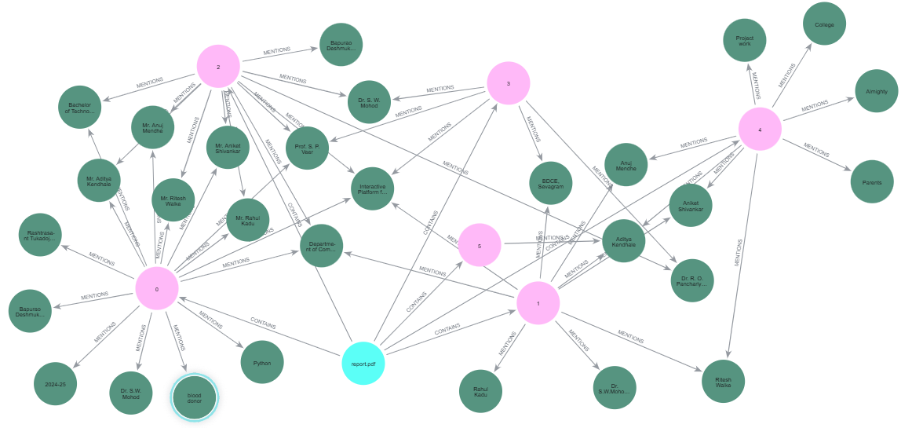
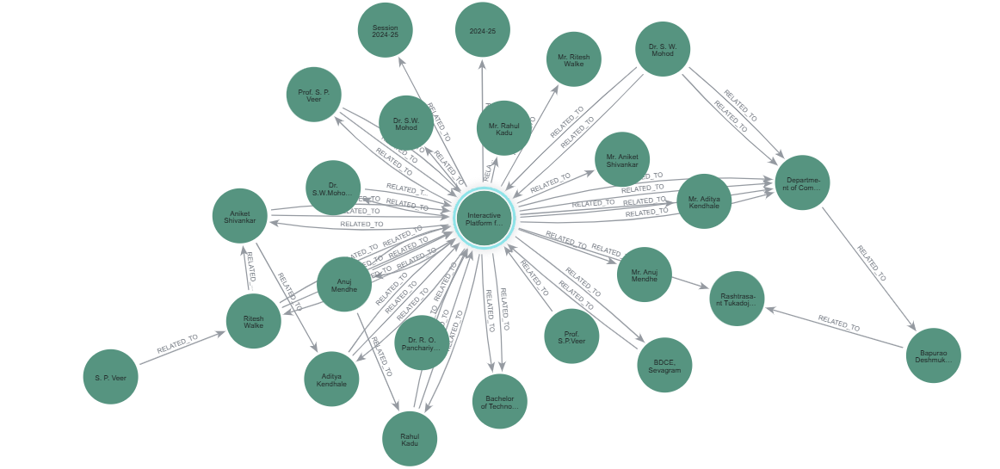

# 🧠 Graph RAG Assistant

A **Graph Retrieval-Augmented Generation (Graph RAG)** application built with Python, Neo4j, Groq, and semantic search. It combines knowledge graphs, vector similarity, and large language models to answer questions using relevant information from PDF documents.

The application currently focuses on the *Interactive Platform for Blood Donation* document. Users can ask questions through a Streamlit chat interface and inspect the source passages used to generate answers.

---

## 📌 Table of Contents

1. [Project Overview](#-project-overview)
2. [Why Graph RAG?](#-why-graph-rag)
3. [Features](#-features)
4. [Technology Stack](#-technology-stack)
5. [System Architecture](#-system-architecture)
6. [Project Structure](#-project-structure)
7. [How It Works](#-how-it-works)
8. [Knowledge Graph Design](#-knowledge-graph-design)
9. [Hybrid Retrieval](#-hybrid-retrieval)
10. [Answer Generation](#-answer-generation)
11. [Installation and Setup](#-installation-and-setup)
12. [Environment Configuration](#-environment-configuration)
13. [Running the Application](#-running-the-application)
14. [Screenshots](#-screenshots)
15. [Important Modules](#-important-modules)
16. [Current Limitations and Future Improvements](#-current-limitations-and-future-improvements)

---

## 📖 Project Overview

Traditional Retrieval-Augmented Generation (RAG) systems primarily retrieve text chunks based on semantic similarity. Although this works well for many questions, it can struggle when a question requires understanding relationships between multiple entities.

This project explores **Graph RAG**, which combines:

- **Knowledge Graphs:** Represent entities and their relationships.
- **Vector Search:** Retrieve semantically similar text chunks.
- **Graph Search:** Explore connections between entities.
- **Large Language Models:** Generate natural-language answers from retrieved evidence.

Neo4j stores the knowledge graph, Sentence Transformers generate text embeddings, and Groq provides LLM-powered entity extraction and answer generation.

### Main objective

Build a question-answering system that can retrieve relevant information from a document using both semantic similarity and knowledge-graph relationships.

---

## 💡 Why Graph RAG?

Consider the question:

> How does a blood donor contribute to the blood bank?

A traditional vector-based RAG system searches for text chunks that are semantically similar to the question.

A Graph RAG system can additionally explore relationships between concepts such as:

- Blood Donor
- Blood Donation
- Blood Bank
- Blood Collection
- Blood Storage

This makes it possible to retrieve information through both textual relevance and connected knowledge.

| Traditional RAG | Graph RAG |
|---|---|
| Primarily retrieves text chunks | Retrieves text and graph-connected evidence |
| Uses vector similarity | Combines vector and graph retrieval |
| Focuses on semantic relevance | Can explore entity relationships |
| Useful for direct questions | Useful for relationship-based and multi-hop questions |

---

## ✨ Features

### 1. PDF Document Processing

- Extracts text from PDF documents.
- Splits extracted text into smaller chunks.
- Preserves document and page-related metadata.
- Prepares chunks for entity extraction and retrieval.

### 2. Entity Extraction

- Uses an LLM through Groq to identify entities.
- Extracts structured entity information.
- Prepares entities and relationships for graph storage.

### 3. Knowledge Graph Construction

- Uses Neo4j as the graph database.
- Stores entities as graph nodes.
- Stores relationships as graph connections.
- Connects document chunks with the entities they mention.
- Supports graph exploration and visualization.

### 4. Semantic Search

- Uses Sentence Transformers for text embeddings.
- Uses the `all-MiniLM-L6-v2` embedding model.
- Retrieves relevant chunks using vector similarity.
- Supports document-aware retrieval.

### 5. Graph Search

- Searches for relevant entities.
- Explores relationships between connected entities.
- Supports multi-hop graph traversal.
- Applies document filtering to retrieved evidence.

### 6. Hybrid Retrieval

Combines multiple retrieval techniques:

- Semantic vector search.
- Knowledge graph search.
- Multi-hop relationship exploration.

### 7. LLM Answer Generation

- Uses Groq to generate natural-language answers.
- Uses retrieved evidence as context.
- Separates retrieved evidence from the final answer-generation stage.

### 8. Streamlit Chat Interface

- Interactive chat interface.
- Maintains conversation history during the session.
- Displays detected entities.
- Displays generated answers.
- Allows users to inspect retrieved source passages.
- Shows chunk IDs, PDF page numbers, similarity scores, and retrieval methods.

---

## 🛠️ Technology Stack

| Technology | Purpose |
|---|---|
| Python 3.12 | Main programming language |
| Streamlit | Chat application interface |
| Neo4j | Knowledge graph database |
| Cypher | Graph database query language |
| Groq API | LLM-powered extraction and generation |
| Sentence Transformers | Text embedding generation |
| all-MiniLM-L6-v2 | Embedding model |
| PyPDF | PDF text extraction |
| LangChain Text Splitters | Text chunking |
| LangChain Community | Supporting document-processing integrations |
| python-dotenv | Environment variable management |
| uv | Python dependency and environment management |

---

## 🏗️ System Architecture

The application follows a modular architecture that separates document ingestion, graph construction, retrieval, and answer generation.

### High-level workflow

```text
                 PDF DOCUMENT
                       |
                       v
              DOCUMENT LOADING
                       |
                       v
                 TEXT SPLITTING
                       |
                       v
              ENTITY EXTRACTION
                  (Groq LLM)
                       |
                       v
              KNOWLEDGE GRAPH
                  (Neo4j)
                       |
                       v
              TEXT EMBEDDINGS
             (Sentence Transformers)
                       |
                       v
                USER QUESTION
                       |
                       v
               GRAPH RAG RETRIEVER
                       |
             +---------+---------+
             |                   |
             v                   v
       SEMANTIC SEARCH       GRAPH SEARCH
       Vector Retrieval     Entity & Relations
             |                   |
             +---------+---------+
                       |
                       v
                HYBRID RETRIEVAL
                       |
                       v
                ANSWER GENERATION
                   (Groq LLM)
                       |
                       v
                 FINAL ANSWER
                       |
                       v
               STREAMLIT CHAT UI
```

---

## 📁 Project Structure

```text
graph-rag-assistant/
│
├── src/
│   │
│   ├── config/
│   │   ├── __init__.py
│   │   └── settings.py
│   │
│   ├── extraction/
│   │   ├── __init__.py
│   │   ├── entity_extractor.py
│   │   └── extraction_schema.py
│   │
│   ├── graph/
│   │   ├── __init__.py
│   │   ├── chunk_reader.py
│   │   ├── graph_builder.py
│   │   └── neo4j_connection.py
│   │
│   ├── ingestion/
│   │   ├── __init__.py
│   │   ├── document_loader.py
│   │   ├── graph_pipeline.py
│   │   └── text_splitter.py
│   │
│   └── retrieval/
│       ├── __init__.py
│       ├── answer_generator.py
│       ├── cypher_executor.py
│       ├── cypher_generator.py
│       ├── graph_rag_retriever.py
│       ├── graph_search.py
│       └── hybrid_search.py
│
├── screenshots/
│   ├── Document_Visualisation.png
│   └── Entity_Visualisation.png
│
├── app.py
├── evaluation_questions.py
├── Knowledge_Graph_Visualization_README.md
├── pyproject.toml
├── uv.lock
├── .env.example
├── .gitignore
└── README.md
```

### Module responsibilities

| Module | Responsibility |
|---|---|
| `config/settings.py` | Loads application configuration and environment variables |
| `extraction/entity_extractor.py` | Extracts entities and relationship information |
| `extraction/extraction_schema.py` | Defines the structured extraction format |
| `graph/neo4j_connection.py` | Establishes and manages Neo4j connections |
| `graph/graph_builder.py` | Creates and manages graph data |
| `graph/chunk_reader.py` | Reads document chunk information from the graph |
| `ingestion/document_loader.py` | Loads and extracts PDF content |
| `ingestion/text_splitter.py` | Splits document text into chunks |
| `ingestion/graph_pipeline.py` | Coordinates the document ingestion and graph-building workflow |
| `retrieval/graph_search.py` | Performs entity and relationship-based graph retrieval |
| `retrieval/cypher_generator.py` | Generates Cypher queries |
| `retrieval/cypher_executor.py` | Executes Cypher queries |
| `retrieval/hybrid_search.py` | Combines graph and semantic retrieval |
| `retrieval/graph_rag_retriever.py` | Coordinates the retrieval workflow |
| `retrieval/answer_generator.py` | Generates answers using retrieved evidence |
| `app.py` | Runs the Streamlit chat application |
| `evaluation_questions.py` | Contains questions used for retrieval and answer evaluation |

---

## ⚙️ How It Works

### Step 1: Document Loading

The PDF document is loaded using PyPDF.

The extracted text is prepared for further processing.

### Step 2: Text Chunking

The document text is divided into smaller chunks.

Chunking makes it easier to:

- Process large documents.
- Extract entities from manageable sections.
- Generate embeddings.
- Retrieve relevant passages.

Each chunk retains useful metadata, including its document identity and page information.

### Step 3: Entity Extraction

The extracted chunks are processed using an LLM through the Groq API.

The extraction process identifies entities and their relationships.

For example:

```text
Blood Donor
    |
    | participates in
    v
Blood Donation
    |
    | contributes to
    v
Blood Bank
```

The extracted information is structured before being stored in Neo4j.

### Step 4: Knowledge Graph Construction

Neo4j stores the extracted information as nodes and relationships.

Document chunks are connected to the entities they contain.

This structure allows the application to explore relationships between concepts rather than relying only on isolated text passages.

### Step 5: Embedding Generation

Sentence Transformers converts text chunks into numerical vectors.

The project uses:

```text
all-MiniLM-L6-v2
```

These embeddings represent the semantic meaning of the text and are used for similarity-based retrieval.

### Step 6: User Question

The user enters a question through the Streamlit chat interface.

The question is passed to the Graph RAG retrieval pipeline.

### Step 7: Hybrid Retrieval

The retrieval system uses semantic and graph-based search.

**Semantic retrieval:**

Finds text chunks that are semantically similar to the question.

**Graph retrieval:**

Identifies relevant entities and explores their relationships.

**Multi-hop retrieval:**

Explores connections across multiple graph relationships to discover additional relevant evidence.

The retrieved results are combined to provide context for answer generation.

### Step 8: Answer Generation

The retrieved evidence is passed to the answer generator.

Groq generates a natural-language response based on the available context.

### Step 9: Source Display

The Streamlit application displays the generated answer.

Users can expand the source section to inspect:

- Chunk ID
- PDF page number
- Similarity score
- Retrieval source
- Retrieved text passage

This makes it easier to understand where the answer's supporting information came from.

---

## 🕸️ Knowledge Graph Design

The knowledge graph represents information using entities, relationships, documents, and text chunks.

A simplified conceptual structure:

```text
(Document)
    |
    | CONTAINS
    v
(Chunk)
    |
    | MENTIONS
    v
(Entity)
    |
    | RELATES_TO
    v
(Entity)
```

### Main graph concepts

| Graph element | Description |
|---|---|
| Document | Represents the source PDF |
| Chunk | Represents a section of extracted document text |
| Entity | Represents a concept identified in the document |
| Relationship | Represents a connection between entities |
| Chunk-Entity connection | Links extracted concepts to their supporting text |

The graph enables the retrieval system to combine textual evidence with connected knowledge.

For more details about graph visualization, see [Knowledge Graph Visualization Documentation](Knowledge_Graph_Visualization_README.md).

---

## 🔎 Hybrid Retrieval

Hybrid retrieval is one of the central parts of this project.

Instead of relying on only one retrieval method, the system combines different approaches.

### Semantic Search

Semantic search uses vector embeddings to identify text passages with similar meaning.

For example, a question about blood donation may retrieve a passage even if the exact wording differs.

### Graph Search

Graph search identifies entities and explores their connections.

For example:

```text
Blood Donor
    |
    v
Blood Donation
    |
    v
Blood Bank
    |
    v
Blood Storage
```

### Multi-Hop Search

Multi-hop search explores relationships across multiple steps.

A one-hop search explores directly connected entities, while a two-hop search can explore connections through an additional relationship.

The implementation validates the maximum hop count to keep traversal within a controlled range.

### Document-Aware Retrieval

The retrieval pipeline supports a `document_id` parameter.

This helps restrict retrieved evidence to a particular document when required, rather than mixing evidence from unrelated documents.

---

## 🤖 Answer Generation

The answer generator uses the Groq API to produce responses from retrieved context.

Its responsibilities include:

1. Receiving the user's question.
2. Receiving retrieved evidence.
3. Preparing context for the language model.
4. Generating a natural-language answer.
5. Returning the answer to the Streamlit interface.

The objective is to ground answers in retrieved document evidence instead of relying only on the language model's general knowledge.

---

## 🚀 Installation and Setup

### Prerequisites

Before running the project, install:

- Python 3.12
- uv
- Neo4j database (local Neo4j or Neo4j AuraDB)
- Groq API account and API key

### 1. Clone the repository

```bash
git clone https://github.com/812anuj/graph-rag-assistant.git
```

### 2. Navigate into the project

```bash
cd graph-rag-assistant
```

### 3. Create the virtual environment and install dependencies

```bash
uv sync
```

This installs the dependencies defined in `pyproject.toml` and `uv.lock`.

### 4. Configure environment variables

Create a `.env` file in the project root.

Use `.env.example` as the starting point and configure the required values.

### 5. Configure Neo4j

Create or use a Neo4j database.

Obtain the connection URI, username, password, and database name.

Make sure the database is running and accessible before starting the application.

---

## 🔐 Environment Configuration

The application uses environment variables to keep credentials outside the source code.

Example `.env` configuration:

```env
NEO4J_URI=bolt://localhost:7687
NEO4J_USERNAME=neo4j
NEO4J_PASSWORD=your_password_here
NEO4J_DATABASE=neo4j

GROQ_API_KEY=your_groq_api_key_here
```

For Neo4j AuraDB, use the connection URI provided by your AuraDB instance instead of the local URI.

**Important security notes:**

- Never upload your actual `.env` file to GitHub.
- Never expose your Neo4j password or Groq API key.
- Keep `.env` in `.gitignore`.
- Use placeholder values in `.env.example`.
- Do not commit private documents or credentials.

---

## ▶️ Running the Application

After installing dependencies and configuring the environment variables, start the application:

```bash
uv run streamlit run app.py
```

Streamlit will start the application and provide a local URL, usually:

```text
http://localhost:8501
```

Open the URL in your browser.

The application will attempt to connect to Neo4j. After a successful connection, you can enter questions through the chat interface.

---

## 📸 Screenshots

### Document Visualization

This visualization shows the document-related structure stored in the knowledge graph.



### Entity Visualization

This visualization shows entities and their connections in the knowledge graph.



---

## 📂 Important Files

| File | Purpose |
|---|---|
| `app.py` | Main Streamlit application |
| `pyproject.toml` | Project metadata and dependency definitions |
| `uv.lock` | Locked dependency versions |
| `.env.example` | Example environment configuration |
| `.gitignore` | Prevents private and generated files from being committed |
| `evaluation_questions.py` | Evaluation and testing questions |
| `Knowledge_Graph_Visualization_README.md` | Additional graph visualization documentation |

---

## ⚠️ Current Limitations and Future Improvements

The current implementation is a working Graph RAG prototype focused on a configured blood-donation PDF document.

The following improvements are planned:

- [ ] Add a PDF upload interface.
- [ ] Support ingestion of multiple user-uploaded documents.
- [ ] Add document selection for question answering.
- [ ] Improve document-level isolation throughout graph retrieval.
- [ ] Add more comprehensive automated tests.
- [ ] Improve error handling and API rate-limit handling.
- [ ] Add retrieval-quality evaluation metrics.
- [ ] Improve chat history persistence.
- [ ] Add deployment configuration.
- [ ] Improve logging and monitoring.

These are future improvements and should not be considered completed features.

---

## 🎯 Learning Outcomes

Through this project, I worked with:

- Retrieval-Augmented Generation (RAG).
- Graph-based knowledge representation.
- Neo4j and Cypher queries.
- PDF processing and text chunking.
- LLM-based entity extraction.
- Sentence Transformer embeddings.
- Vector similarity search.
- Hybrid retrieval techniques.
- Multi-hop graph traversal.
- Groq API integration.
- Modular Python application architecture.
- Streamlit application development.

---

## 👨‍💻 Author

**Anuj Mendhe**

- GitHub: [@812anuj](https://github.com/812anuj)
- LinkedIn: [Anuj Mendhe](https://www.linkedin.com/in/anuj-mendhe-005673325/)

---

## 📄 License

A license has not yet been added to this repository. Please check the repository for licensing information before reusing or distributing the code.
